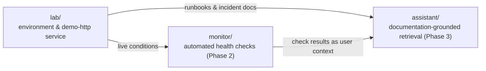

# it-operations-ai-lab

An integrated portfolio demonstrating two focus areas: **IT Specialist**
(systematic troubleshooting, check automation) and **AI Enthusiast**
(documentation-grounded assistance with verifiable citations).

> **30-second summary.** Three connected projects proving two roles through
> artifacts, not claims: **(1) IT Specialist** — a Linux lab environment with
> 5 end-to-end incident scenarios (symptoms → diagnostics → root cause →
> verified recovery) automated by a health monitor; **(2) AI Enthusiast** — a
> documentation-grounded helpdesk assistant with verifiable citations, honest
> abstention, and prompt-injection defenses.
> **103 automated tests green · 57 real-execution evidence files · 0 safety
> violations in a 21-case evaluation · every claim traceable to evidence.**
> Quick navigation: [Repo map](#repo-map) ·
> [6-minute verification](#510-minute-demo-guide-for-interviews) ·
> [PORTFOLIO.en.md](PORTFOLIO.en.md) (per-project recruiter summary).

Three components:

1. **IT Support Homelab** (`lab/` + `docs/`) — an isolated lab environment, a
   practice service, and incident scenarios with runbooks.
2. **System Health Monitor** (`monitor/`) — a Python CLI automating baseline
   checks. *(implemented — Phase 2)*
3. **AI Helpdesk Assistant** (`assistant/`) — search-only retrieval over the
   runbooks with citations; it **never executes commands**. *(implemented —
   Phase 3, Stage A; the model adapter is planned for Stage B)*

> **Honest status as of Phase 3 (2026-11-26):** all three components are done.
> Phase 1 (5/5 incidents), Phase 2 (monitor: 58 unit tests + integration +
> live webhook + scheduler), Phase 3 (assistant search-only: 45 unit tests +
> a 21-case evaluation with zero safety violations + live server). All claims
> are backed by real execution evidence in `docs/evidence/`. Execution on the
> owner's VM is *requires manual verification*. No untested claims — see the
> status table below and `docs/evidence/`.

## Documentation languages

**Bahasa Indonesia is the primary documentation** (repo convention: technical
terms and code identifiers stay in English). English mirrors use the
`.en.md` suffix next to the originals and are kept in sync:

| English mirror | Indonesian original |
|---|---|
| `README.en.md` (this file) | `README.md` |
| `PORTFOLIO.en.md` | `PORTFOLIO.md` |
| `lab/README.en.md` | `lab/README.md` |
| `monitor/README.en.md` | `monitor/README.md` |
| `assistant/README.en.md` | `assistant/README.md` |
| `docs/incidents/README.en.md`, `INC-001-service-down.en.md` | `docs/incidents/README.md`, `INC-001-service-down.md` |
| `docs/runbooks/RB-001-service-down.en.md` | `docs/runbooks/RB-001-service-down.md` |
| `docs/evidence/README.en.md` | `docs/evidence/README.md` |
| `docs/security/safety-rules.en.md` | `docs/security/safety-rules.md` |
| `docs/setup/vm-ubuntu-server.en.md`, `teardown.en.md` | `docs/setup/vm-ubuntu-server.md`, `teardown.md` |
| `docs/architecture/decisions.en.md`, `network-diagram.en.md` (+ `.en.svg`) | `docs/architecture/decisions.md`, `network-diagram.md` (+ `.svg`) |
| `assistant/evaluation/rubrik-manual.en.md` | `assistant/evaluation/rubrik-manual.md` |

Indonesian-only (English available on request): full documents for
INC-002–005 and RB-002–005. Code docstrings/comments are Indonesian by
convention; identifiers are English. If a mirror and its original diverge,
the Indonesian version is the source of truth — please flag it.

## Table of contents

1. [Problem & approach](#what-problem-does-this-solve)
2. [Skills demonstrated](#skills-demonstrated)
3. [Per-feature implementation status](#what-is-actually-implemented)
4. [Architecture: 3 connected components](#how-do-the-three-components-connect)
5. [Repo map](#repo-map)
6. [Quick start](#how-do-i-run-it-quick-start)
7. [Testing & reproduction](#how-do-i-test-and-reproduce-the-incidents)
8. [Execution evidence E00–E53](#where-is-the-evidence--demo)
9. [Why these claims are trustworthy](#why-these-claims-are-trustworthy)
10. [Prerequisites](#prerequisites) · [Limitations](#limitations--security-risks)
11. [Interview demo guide](#510-minute-demo-guide-for-interviews)
12. [Roadmap](#roadmap) · [License](#license)

## What problem does this solve?

IT-operations practice usually stops at "followed a tutorial with no proof".
This repo builds a lab environment that can be **deliberately broken in a
controlled way**, detected automatically, and documented from healthy state
to recovery — with real execution evidence, not invented output.

What makes this repo different from tutorial portfolios:

- **Reproducible** — every evidence file lists its repro commands in the
  header; anyone can re-run the flow from a healthy state.
- **Per-feature claims, not per-project claims** — the status table
  separates implemented / tested / simulated / requires manual verification
  / planned.
- **Safety by design** — disposable fixtures, wrong-target guards, no
  auto-remediation, no secrets in the repo.

## Skills demonstrated

Every skill below has a real artifact you can open in the repo — not a
watched course. "Evidence" = execution files (`docs/evidence/`) or technical
decisions (`docs/architecture/decisions.en.md`).

**Role 1 — IT Specialist:**

| Skill | Demonstrated by | Evidence / artifact |
|---|---|---|
| Linux & systemd | hardened unit (dedicated user, light sandboxing), journald, start-limit | `E01`, `E05`–`E06`, D8 |
| End-to-end incident troubleshooting | 5 scenarios: symptoms → hypotheses → root cause → verified recovery | `E04`–`E31`, `docs/incidents/` |
| Capacity & disk | threshold check + safe simulation via a tmpfs fixture (root fs untouched) | `E10`–`E17`, D12 |
| DNS & networking | DNS/TCP/HTTP checks, host-only + NAT boundary with no inbound | `E18`–`E20`, D3 |
| Bash & POSIX tooling | 11 operational scripts with safety guards & disciplined exit codes | `lab/scripts/` |
| Operational security | least privilege, sudo boundary (a real failure kept as a lesson), no auto-remediation | `E03`, D8, safety-rules |
| Automation & scheduling | systemd timer: `verify` + a real trigger + results in journald | `E42` |
| Technical documentation | 16 ADRs (context→decision→trade-off), 16-section incidents, runbooks | `decisions.md`, `docs/incidents/` |

**Role 2 — AI Enthusiast:**

| Skill | Demonstrated by | Evidence / artifact |
|---|---|---|
| Grounded RAG + citations | extractive answers + chunk metadata (id/hash/path) + server-side citation re-validation | `E45`, `E50`, D16 |
| Information retrieval | stdlib BM25 Okapi implementation + abstain-threshold calibration | `E49`, D16 |
| Honest retrieval/model evaluation | metrics split per aspect, p50/p95 latency, tokens/cost N/A with a reason, manual rubric | `assistant/evaluation/report.md` |
| Prompt-injection security | injection instructions structurally impossible to obey (extractive) + pattern detection + test fixture | `E47`, `tests/test_security.py` |
| API engineering | local-bind FastAPI, input limits, logs without query content | `E50` |
| Software engineering discipline | 103 tests green, clean ruff, CI lint+test+evaluation | `E34`, `E43`, `ci.yml` |

## What is actually implemented?

| Area | Status |
|---|---|
| Practice service `demo-http` (stdlib-only) + hardened systemd unit | implemented, tested (sandbox) |
| Service installer / uninstaller | implemented, tested (sandbox) |
| `baseline.sh`: disk, service, DNS, TCP, HTTP + exit codes 0/1/2 | implemented, tested (sandbox) |
| Incident-simulation scripts with safety guards | implemented, tested (sandbox) |
| INC-001 end-to-end flow (healthy → outage → symptoms → diagnosis → recovery) | implemented + **tested**; the incident itself is *simulated* (a controlled drill) |
| INC-002 disk pressure (disposable tmpfs fixture) | implemented + **tested** (sandbox); requires manual verification on VM |
| INC-003 DNS failure (Level A: `.invalid` name, resolver untouched) | implemented + **tested** (sandbox); Level B (resolver on a disposable VM) requires manual verification |
| INC-004 wrong file permission (chmod 000 → restart fails → recovery) | implemented + **tested** (sandbox); requires manual verification on VM |
| INC-005 port conflict (lab squatter + cmdline-verified kill) | implemented + **tested** (sandbox); requires manual verification on VM |
| Monitor: 5 checks (disk/service/DNS/TCP/HTTP) + strict config validation | implemented + **tested** (58 unit tests, local integration) |
| Monitor: exit codes 0/1/2, JSON + text output, timezone timestamps | implemented + **tested** |
| Monitor: webhook alerts (env-based, dedup, retry) | implemented + **tested** + live-send evidence |
| Monitor: JSON logging with rotation, systemd-timer scheduler | implemented; unit verified; periodic runs on VM = requires manual verification |
| Assistant: explicit KB builder + BM25 search-only + validated citations | implemented + **tested** (45 unit tests; 21-case evaluation) |
| Assistant: out-of-scope abstain + injection labeling + local UI | implemented + **tested** (+ live server) |
| Assistant: Stage-B model adapter (local/API) | planned (interface ready; refuses to run explicitly) |
| Executing the VMware + Ubuntu 24.04 setup guide on the owner's VM | requires manual verification |

Status definitions: `docs/security/safety-rules.md` §3.

## How do the three components connect?



- The homelab provides the environment, incidents, and runbooks.
- The monitor detects failing conditions in that environment (exit codes
  0/1/2 consumed by the scheduler).
- The assistant **only helps find** the documented steps with citations; it
  never executes commands and never auto-remediates.

## Repo map

```
it-operations-ai-lab/
├── README.md               ← Indonesian original · README.en.md (you are here)
├── PORTFOLIO.en.md         ← per-project recruiter summary + evidence map
├── lab/                    ← Phase 1: practice service + 11 incident scripts
├── monitor/                ← Phase 2: health-check CLI (58 unit tests)
├── assistant/              ← Phase 3: search-only assistant (45 tests, 21-case evaluation)
├── docs/
│   ├── architecture/       ← network diagram + 16 technical decisions (ADRs)
│   ├── evidence/           ← 57 real-execution evidence files (E00–E53)
│   ├── incidents/          ← 5 sixteen-section incident documents (INC-001..005)
│   ├── runbooks/           ← 5 quick runbooks (the assistant's KB source)
│   ├── security/           ← lab safety rules & evidence labels
│   └── setup/              ← VMware/Ubuntu VM guide + teardown
└── .github/workflows/      ← CI: lint + unit tests + assistant evaluation
```

Fastest reading path for recruiters: `PORTFOLIO.en.md` →
`docs/evidence/E41` → `assistant/evaluation/report.md` → `decisions.en.md`
(D14, D16).

## How do I run it? (quick start)

Easiest path, on Ubuntu Server 24.04 per `docs/setup/vm-ubuntu-server.en.md`:

```bash
cd ~/it-operations-ai-lab
sudo bash lab/scripts/install_demo_service.sh      # install the service
bash lab/scripts/baseline.sh                       # healthy baseline (exit 0)
sudo bash lab/scripts/simulate_service_down.sh --yes   # controlled outage
bash lab/scripts/baseline.sh                       # symptoms (exit 1)
sudo bash lab/scripts/recover_service.sh           # recover + verify
bash lab/scripts/baseline.sh                       # healthy again (exit 0)
```

Without a VM (any Linux host with systemd) the steps are identical. Baseline
configuration is via environment variables — see the header of
`lab/scripts/baseline.sh`. Teardown: `docs/setup/teardown.en.md`.

### Monitor (Phase 2)

```bash
cd ~/it-operations-ai-lab
python3 -m venv .venv
.venv/bin/pip install -e 'monitor[dev]'
cp monitor/config.example.json monitor/config.json   # adjust if needed
.venv/bin/lab-monitor --config monitor/config.json   # text report, exit 0/1/2
```

Details (config reference, webhook, systemd-timer scheduler):
`monitor/README.en.md`.

### Assistant (Phase 3, search-only)

```bash
cd ~/it-operations-ai-lab
python3 -m venv .venv
.venv/bin/pip install -e 'assistant[dev]'
.venv/bin/lab-assist query "demo-http service stopped, how do I diagnose it?"
.venv/bin/lab-assist serve                # local UI at http://127.0.0.1:8077
python3 assistant/evaluation/evaluate.py  # evaluation report (report.md)
```

Answers are extractive quotes from the runbooks with citations; it abstains
when the documentation does not cover the question; it never executes
commands. Details: `assistant/README.en.md`. The manual-scoring rubric
template is `assistant/evaluation/rubrik-manual.en.md` (not yet filled →
requires manual verification).

## How do I test and reproduce the incidents?

- Homelab: `bash -n lab/scripts/*.sh` (syntax) + the six quick-start commands
  above to reproduce INC-001.
- Monitor unit tests (deterministic, mocked, no internet/VM):
  `python3 -m pytest monitor/tests` → 58 pass.
- Monitor local integration (requires demo-http running):
  `python3 -m pytest monitor/tests -m integration`.
- Assistant unit tests: `python3 -m pytest assistant/tests` → 45 pass.
- Assistant evaluation: `python3 assistant/evaluation/evaluate.py` → 21 cases,
  report in `assistant/evaluation/report.md`.
- Lint: `ruff check` for monitor & assistant → clean.
- CI: `.github/workflows/ci.yml` runs ruff + both packages' unit tests + the
  assistant evaluation on Python 3.12 (no secrets, no internet, integration
  tests excluded). CI runs once the repo is pushed — requires manual
  verification.

## Where is the evidence / demo?

`docs/evidence/` — **actual** output (not examples) from sandbox executions,
with environment headers and timestamps. Full index:
`docs/evidence/README.en.md`. Highlights:

| Evidence | Result |
|---|---|
| `E01` | installation: system user created, unit active, `/health` 200 |
| `E02` / `E08` | INC-001: baseline 5/5 healthy (before & after), exit 0 |
| `E03` | **real failure**: stopping without sudo rejected by systemd (`Access denied`) |
| `E03b`–`E06` | INC-001: outage, symptoms (exit 1), status & journald diagnostics |
| `E07` | INC-001: verified recovery (service active + HTTP 200) |
| `E09` | clean teardown |
| `E10`–`E17` | INC-002: 32 MB tmpfs fixture → filled 88% → disk FAIL (exit 1) → recovery (exit 0) → teardown |
| `E18`–`E20` | INC-003: DNS failure (exit 1) → diagnostics rc=2 vs rc=0 → recovery (exit 0) |
| `E21`–`E26` | INC-004: chmod 000 → `Errno 13` + `status=2` → unit failed → recovery (exit 0) |
| `E27`–`E33` | INC-005: port squatter → deceptive symptoms (service FAIL, tcp/http OK) → `Errno 98` → verified kill → recovery (exit 0) |
| `E33b` | monitor integration test against the local lab: 1 pass |
| `E34` / `E35` | monitor: 58 unit tests pass; ruff clean |
| `E36` / `E37` / `E38` | monitor: healthy CLI exit 0, timezone JSON, invalid config exit 2 |
| `E39` / `E40` | monitor: live webhook — sent + dedup (1 POST) / failure mode (health results intact) |
| `E41` | required homelab flow: healthy → outage → monitor exit 1 → recovery → exit 0 |
| `E42` | scheduler: `systemd-analyze verify` passes + real service trigger (journald + JSON log) |
| `E43`–`E44` | assistant: 43 unit tests pass; ruff clean |
| `E45`–`E47` | assistant CLI: answered + citations, out-of-scope abstain, injection → safety_note |
| `E48` | 21-case evaluation: hit@k 0.889, citations 1.0, abstain 1.0, safety 1.0, latency reported |
| `E49`–`E50` | KB 133 chunks/11 docs (explicit dirs); live FastAPI server (health/query/abstain/limits/relative-URL UI) |
| `E51` | final repo QA: CI YAML valid, secret grep clean, README 7/7 checklist, re-runs green |
| `E52` | docs polish QA (recruiter perspective): new structure 5/5, links & numbers consistent + honest annotation |
| `E53` | EN-mirror side effect on the KB (hit@k briefly 1.0) → fixed with `exclude_globs` (D17) → baseline restored: 0.889, 133/11, 45 tests |

Architecture & network diagrams: `docs/architecture/` (Mermaid + SVG).
Technical decisions & trade-offs: `docs/architecture/decisions.en.md`.
Per-project recruiter summaries + evidence quick map: `PORTFOLIO.en.md`.

## Why these claims are trustworthy

- **Every claim → evidence.** Numbers in this repo (103 tests, hit@k 0.889,
  p50/p95 latency) come from real executions with environment headers and
  dates — illustrative output is always labeled `CONTOH` (example).
- **Failures are kept, not deleted.** `E03` (stop without sudo rejected by
  systemd), `E28` (the settle logic missed on the first recording), and the
  first monitor test run with 10 failing tests are preserved as-is and
  analyzed — how failures are handled is part of the portfolio.
- **AI numbers are never merged into one.** Retrieval, citation, abstain,
  and safety are reported separately; tokens/cost are reported N/A because
  there is no provider — not hidden.
- **Explicit repro.** Every claim can be re-verified: repro commands are in
  each evidence header and in the demo guide.

## Prerequisites

- VM path: Windows 10/11 + VMware Workstation Pro 17.5.2+ (free for personal
  use), Ubuntu Server 24.04 LTS ISO, ≥ 8 GB RAM, ≥ 30 GB free disk.
- Linux host path: systemd, bash, curl, df, timeout, getent — no root needed
  for `baseline.sh`.
- Python ≥ 3.10 (for `demo_http_server.py`; Phases 2/3 use newer Python).

## Limitations & security risks

- `demo-http` uses `http.server` — **not a production server**.
- Host-only lab network: no bridging, no inbound port-forwarding, no real
  data on lab services (`docs/security/safety-rules.en.md`).
- Current evidence comes from a sandbox (not the VM). Sandbox tests are not
  equated to VM tests; VM verification is the next step.
- Incident simulation requires `sudo` — matching systemd's protection of
  system units; a service-name guard prevents wrong targets.
- No auto-remediation anywhere: recovery is always manual and verified.

## 5–10 minute demo guide (for interviews)

1. **1 min** — show the diagram (`docs/architecture/`) and explain how the
   three components connect.
2. **1 min** — open `docs/evidence/E02` and `E04`: healthy vs symptoms,
   exit code 0 vs 1.
3. **3 min** — run the quick-start flow live: simulate → failing baseline →
   `systemctl status` + `journalctl` → recover → healthy baseline. Narrate
   hypotheses as symptoms appear.
4. **2 min** — assistant live: answered query with citations → out-of-scope
   abstain → injection query (safety note). Emphasize: no command execution,
   citations open in the repo.
5. **2 min** — discuss the hardest technical decisions (D6 `Restart=on-failure`
   vs `always`; D14 the two failure signatures under restart policies; D16
   extractive vs generative answers + abstain-threshold calibration) and the
   roadmap (VM verification + Stage B).

## Roadmap

- Execute the VM guide on the Windows host + re-verify the incident, monitor,
  and assistant flows on the VM (replacing *requires manual verification*).
- Assistant Stage B: one provider adapter (local/API) with an explicit cost
  config sourced from the official pricing page (model, rate, rate date) +
  token usage reported from provider responses; the offline mode stays
  functional.
- INC-003 Level B (breaking the resolver on a disposable VM) to complement
  the tested Level A.

## License

MIT — see `LICENSE` (including a note that the license does not cover
third-party assets such as VMware Workstation and Ubuntu).
