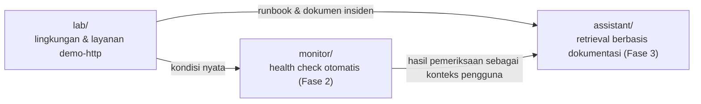

# it-operations-ai-lab

Portofolio terintegrasi untuk dua fokus: **IT Specialist** (troubleshooting
sistematis, otomasi pemeriksaan) dan **AI Enthusiast** (asisten berbasis
dokumentasi dengan kutipan sumber yang bisa diperiksa).

Tiga komponen:

1. **IT Support Homelab** (`lab/` + `docs/`) — lingkungan VM terisolasi,
   layanan latihan, dan skenario insiden dengan runbook.
2. **System Health Monitor** (`monitor/`) — CLI Python yang mengotomasi
   pemeriksaan baseline. *(planned — Fase 2)*
3. **AI Helpdesk Assistant** (`assistant/`) — pencarian/pembahasan dari
   runbook dengan kutipan sumber; **tidak pernah mengeksekusi perintah**.
   *(planned — Fase 3)*

> **Status jujur per Fase 1 (2026-11-26):** kelima skenario insiden
> (INC-001–005) berjalan end-to-end dan diuji di sandbox agent (Debian 13
> + systemd) dengan bukti eksekusi nyata di `docs/evidence/`. Eksekusi di VM
> milik pemilik repo berstatus *requires manual verification*. Tidak ada klaim
> pengujian yang belum dijalankan — lihat tabel status di bawah.

## Masalah apa yang diselesaikan?

Latihan IT operations biasanya berhenti di "ikut tutorial tanpa bukti".
Repo ini membuat lingkungan lab yang **bisa diinsidenkan secara terkontrol**,
dideteksi otomatis, dan didokumentasikan dari kondisi normal sampai pulih —
dengan bukti eksekusi nyata, bukan output yang dikarang.

## Apa yang benar-benar diimplementasikan?

| Bagian | Status |
|---|---|
| Layanan latihan `demo-http` (stdlib-only) + unit systemd ber-hardening | implemented, tested (sandbox) |
| Installer / uninstaller layanan | implemented, tested (sandbox) |
| `baseline.sh`: disk, service, DNS, TCP, HTTP + exit code 0/1/2 | implemented, tested (sandbox) |
| Skrip simulasi insiden dengan guard keselamatan | implemented, tested (sandbox) |
| Alur INC-001 end-to-end (normal → gangguan → gejala → diagnostik → pulih) | implemented + **tested**; insiden = *simulated* (drill terkontrol) |
| INC-002 disk pressure (fixture tmpfs disposable) | implemented + **tested** (sandbox); requires manual verification di VM |
| INC-003 DNS gagal (Level A: nama `.invalid`, tanpa ubah resolver) | implemented + **tested** (sandbox); Level B (resolver di VM) requires manual verification |
| INC-004 permission file salah (chmod 000 → restart gagal → pulih) | implemented + **tested** (sandbox); requires manual verification di VM |
| INC-005 konflik port (squatter lab + kill terverifikasi cmdline) | implemented + **tested** (sandbox); requires manual verification di VM |
| Eksekusi panduan setup VM VMware + Ubuntu 24.04 di VM pemilik repo | requires manual verification |
| Fase 2: `monitor/` (Python, pytest, JSON, notifikasi) | planned |
| Fase 3: `assistant/` (retrieval runbook + kutipan, mode offline) | planned |

Definisi status: `docs/security/safety-rules.md` §3.

## Bagaimana ketiga komponen terhubung?



- Homelab menyediakan lingkungan, insiden, dan runbook.
- Monitor mendeteksi kondisi bermasalah di lingkungan itu (exit code 0/1/2
  yang dipakai scheduler).
- Assistant **hanya membantu mencari** langkah dari dokumentasi dengan
  kutipan; tidak mengeksekusi perintah dan tidak memperbaiki otomatis.

## Bagaimana menjalankannya? (quick start)

Jalur termudah, di VM Ubuntu Server 24.04 per `docs/setup/vm-ubuntu-server.md`:

```bash
cd ~/it-operations-ai-lab
sudo bash lab/scripts/install_demo_service.sh      # pasang layanan
bash lab/scripts/baseline.sh                       # baseline sehat (exit 0)
sudo bash lab/scripts/simulate_service_down.sh --yes   # gangguan terkontrol
bash lab/scripts/baseline.sh                       # gejala (exit 1)
sudo bash lab/scripts/recover_service.sh           # pulihkan + verifikasi
bash lab/scripts/baseline.sh                       # sehat kembali (exit 0)
```

Tanpa VM (host Linux dengan systemd) langkahnya sama. Konfigurasi baseline
lewat environment variable — lihat header `lab/scripts/baseline.sh`.
Teardown: `docs/setup/teardown.md`.

## Bagaimana menguji dan mereproduksi insiden?

- Sintaks & kompilasi: `bash -n lab/scripts/*.sh`,
  `python3 -m py_compile lab/services/demo-http/demo_http_server.py`.
- Reproduksi INC-001: enam perintah di quick start di atas.
- Pengujian monitor (pytest) menyusul di Fase 2; CI (lint + unit test tanpa
  internet/secret) ditambahkan bersama Fase 2 agar tidak ada workflow yang
  "hijau tanpa memeriksa perilaku penting".

## Di mana bukti / demo?

`docs/evidence/` — output **aktual** (bukan contoh) dari eksekusi sandbox,
dengan header lingkungan dan tanggal. Indeks lengkap: `docs/evidence/README.md`.
Sorotan:

| Bukti | Hasil |
|---|---|
| `E01` | instalasi: user sistem dibuat, unit aktif, `/health` 200 |
| `E02` / `E08` | INC-001: baseline 5/5 sehat (sebelum & sesudah), exit 0 |
| `E03` | **kegagalan nyata**: stop tanpa sudo ditolak systemd (`Access denied`) |
| `E03b`–`E06` | INC-001: gangguan, gejala (exit 1), diagnostik status & journald |
| `E07` | INC-001: pemulihan terverifikasi (service aktif + HTTP 200) |
| `E09` | teardown bersih |
| `E10`–`E17` | INC-002: fixture tmpfs 32 MB → isi 88% → disk FAIL (exit 1) → pulih (exit 0) → teardown |
| `E18`–`E20` | INC-003: DNS gagal (exit 1) → diagnostik rc=2 vs rc=0 → pulih (exit 0) |
| `E21`–`E26` | INC-004: chmod 000 → `Errno 13` + `status=2` → unit failed → pulih (exit 0) |
| `E27`–`E33` | INC-005: squatter port → gejala penipu (service FAIL, tcp/http OK) → `Errno 98` → kill terverifikasi → pulih (exit 0) |

Diagram arsitektur & jaringan: `docs/architecture/` (Mermaid + SVG).
Keputusan teknis & trade-off: `docs/architecture/decisions.md`.

## Prasyarat

- Jalur VM: Windows 10/11 + VMware Workstation Pro 17.5.2+ (gratis personal
  use), Ubuntu Server 24.04 LTS ISO, RAM ≥ 8 GB, disk kosong ≥ 30 GB.
- Jalur host Linux: systemd, bash, curl, df, timeout, getent — tanpa root
  untuk `baseline.sh`.
- Python ≥ 3.10 (untuk `demo_http_server.py`; Fase 2/3 memakai Python lebih
  baru).

## Keterbatasan & risiko keamanan

- `demo-http` memakai `http.server` — **bukan server produksi**.
- Jaringan lab host-only: jangan bridging, jangan port-forward inbound,
  jangan simpan data nyata di layanan lab (`docs/security/safety-rules.md`).
- Bukti saat ini berasal dari sandbox (bukan VM). Uji sandbox tidak disamakan
  dengan uji VM; verifikasi VM adalah langkah berikutnya.
- Simulasi insiden butuh `sudo` — sesuai perilaku systemd yang melindungi
  unit sistem; guard nama layanan mencegah salah sasaran.
- Tanpa auto-remediation: pemulihan selalu manual dan terverifikasi.

## Panduan demo 5–10 menit (untuk wawancara)

1. **1 menit** — tunjukkan diagram (`docs/architecture/`) dan jelaskan
   hubungan 3 komponen.
2. **1 menit** — buka `docs/evidence/E02` dan `E04`: kondisi normal vs
   gejala, exit code 0 vs 1.
3. **3 menit** — jalankan alur quick start di VM/sandbox: simulate →
   baseline gagal → `systemctl status` + `journalctl` → recover → baseline
   sehat. Narasikan hipotesis saat gejala muncul.
4. **2 menit** — buka INC-001 §17: contoh kegagalan nyata (Access denied
   tanpa sudo) dan bagaimana dianalisis/diperbaiki.
5. **2 menit** — jelaskan keputusan teknis yang paling menantang (D6
   `Restart=on-failure` vs `always`; D7 bash vs Python; D8 hardening) dan
   roadmap Fase 2/3 (monitor + retrieval grounded, tanpa eksekusi perintah).

## Roadmap

- **Fase 2:** `monitor/` CLI Python (disk/service/DNS/TCP/HTTP), konfigurasi
  tervalidasi, JSON + logging terstruktur, adapter webhook (off default),
  pytest deterministik + integration test terpisah, scheduler 1 platform,
  CI lint/unit-test.
- **Fase 3:** `assistant/` search-only (TF-IDF/BM25) atas runbook dengan
  metadata chunk + citation, kasus uji 20+ (termasuk prompt injection),
  laporan evaluasi (hit rate, validitas kutipan, abstain, latensi p50/p95),
  adapter model lokal/API setelah retrieval teruji.
- INC-003 Level B (memutus resolver di VM disposable) sebagai pelengkap
  Level A yang sudah teruji.

## Lisensi

MIT — lihat `LICENSE` (termasuk catatan bahwa lisensi tidak mencakup aset
pihak ketiga seperti VMware Workstation dan Ubuntu).
