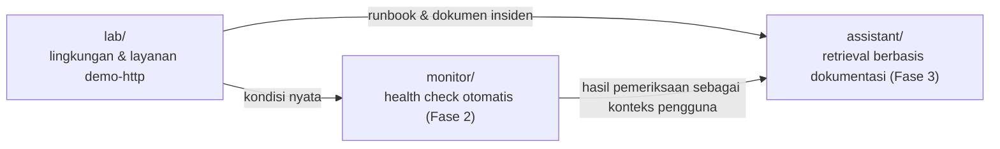

# it-operations-ai-lab

Portofolio terintegrasi untuk dua fokus: **IT Specialist** (troubleshooting
sistematis, otomasi pemeriksaan) dan **AI Enthusiast** (asisten berbasis
dokumentasi dengan kutipan sumber yang bisa diperiksa).

> **Ringkasan 30 detik.** Tiga proyek saling terhubung yang membuktikan dua
> peran lewat artefak, bukan klaim: **(1) IT Specialist** — lingkungan lab
> Linux dengan 5 skenario insiden end-to-end (gejala → diagnostik → root
> cause → pemulihan terverifikasi) yang diotomasi monitor kesehatan;
> **(2) AI Enthusiast** — asisten helpdesk *documentation-grounded* dengan
> kutipan sumber, abstain jujur, dan pertahanan prompt injection.
> **103 test otomatis hijau · 57 file bukti eksekusi nyata · 0 pelanggaran
> keamanan pada evaluasi 21 kasus · setiap klaim bisa dilacak ke bukti.**
> Navigasi cepat: [Peta repo](#peta-repo) ·
> [Verifikasi 6 menit](#panduan-demo-510-menit-untuk-wawancara) ·
> [PORTFOLIO.md](PORTFOLIO.md) (ringkasan per proyek untuk recruiter).

Tiga komponen:

1. **IT Support Homelab** (`lab/` + `docs/`) — lingkungan VM terisolasi,
   layanan latihan, dan skenario insiden dengan runbook.
2. **System Health Monitor** (`monitor/`) — CLI Python yang mengotomasi
   pemeriksaan baseline. *(implemented — Fase 2)*
3. **AI Helpdesk Assistant** (`assistant/`) — pencarian search-only dari
   runbook dengan kutipan sumber; **tidak pernah mengeksekusi perintah**.
   *(implemented — Fase 3, Tahap A; adapter model Tahap B planned)*

> **Status jujur per Fase 3 (2026-11-26):** ketiga komponen selesai. Fase 1
> (5/5 insiden), Fase 2 (monitor: 58 unit test + integration + webhook nyata +
> scheduler), Fase 3 (assistant search-only: 45 unit test + evaluasi 21 kasus
> tanpa pelanggaran keamanan + server nyata). Semua bukti eksekusi nyata di
> `docs/evidence/`. Eksekusi di VM milik pemilik repo berstatus *requires
> manual verification*. Tidak ada klaim pengujian yang belum dijalankan.

> **Bahasa dokumentasi:** dokumen utama bahasa Indonesia. Versi bahasa
> Inggris tersedia sebagai mirror `*.en.md` — mulai dari **[README.en.md](README.en.md)**.
> Matriks file terjemahan ada di README.en.md §Documentation languages.

## Daftar isi

1. [Masalah & pendekatan](#masalah-apa-yang-diselesaikan)
2. [Keahlian yang didemonstrasikan](#keahlian-yang-didemonstrasikan)
3. [Status implementasi per fitur](#apa-yang-benar-benar-diimplementasikan)
4. [Arsitektur: 3 komponen terhubung](#bagaimana-ketiga-komponen-terhubung)
5. [Peta repo](#peta-repo)
6. [Quick start](#bagaimana-menjalankannya-quick-start)
7. [Cara menguji & mereproduksi](#bagaimana-menguji-dan-mereproduksi-insiden)
8. [Bukti eksekusi E00–E53](#di-mana-bukti--demo)
9. [Mengapa klaim ini bisa dipercaya](#mengapa-klaim-ini-bisa-dipercaya)
10. [Prasyarat](#prasyarat) · [Keterbatasan](#keterbatasan--risiko-keamanan)
11. [Panduan demo wawancara](#panduan-demo-510-menit-untuk-wawancara)
12. [Roadmap](#roadmap) · [Lisensi](#lisensi)

## Masalah apa yang diselesaikan?

Latihan IT operations biasanya berhenti di "ikut tutorial tanpa bukti".
Repo ini membuat lingkungan lab yang **bisa diinsidenkan secara terkontrol**,
dideteksi otomatis, dan didokumentasikan dari kondisi normal sampai pulih —
dengan bukti eksekusi nyata, bukan output yang dikarang.

Yang membedakan repo ini dari portofolio tutorial pada umumnya:

- **Reproduksibel** — tiap file bukti mencantumkan perintah repro di
  headernya; siapa pun bisa mengulang alurnya dari kondisi normal.
- **Klaim per fitur, bukan klaim per proyek** — tabel status memisahkan
  implemented / tested / simulated / requires manual verification / planned.
- **Keselamatan by design** — fixture disposable, guard anti-salah-sasaran,
  tanpa auto-remediation, tanpa secret di repo.

## Keahlian yang didemonstrasikan

Setiap keahlian di bawah punya artefak nyata yang bisa dibuka di repo —
bukan kursus yang ditonton. "Bukti" = file eksekusi (`docs/evidence/`) atau
keputusan teknis (`docs/architecture/decisions.md`).

**Peran 1 — IT Specialist:**

| Keahlian | Didemonstrasikan lewat | Bukti / artefak |
|---|---|---|
| Linux & systemd | unit hardened (user khusus, sandboxing ringan), journald, start-limit | `E01`, `E05`–`E06`, D8 |
| Troubleshooting insiden end-to-end | 5 skenario: gejala → hipotesis → root cause → pulih terverifikasi | `E04`–`E31`, `docs/incidents/` |
| Kapasitas & disk | threshold check + simulasi aman via fixture tmpfs (root fs tak tersentuh) | `E10`–`E17`, D12 |
| DNS & jaringan | check DNS/TCP/HTTP, boundary host-only + NAT tanpa inbound | `E18`–`E20`, D3 |
| Bash & POSIX tooling | 11 skrip operasional dengan guard keselamatan & exit code disiplin | `lab/scripts/` |
| Keamanan operasional | least privilege, batas sudo (kegagalan nyata dijadikan pelajaran), tanpa auto-remediation | `E03`, D8, safety-rules |
| Otomasi & scheduling | systemd timer: `verify` + trigger nyata + hasil di journald | `E42` |
| Dokumentasi teknis | 16 ADR (context→decision→trade-off), insiden 16 bagian, runbook | `decisions.md`, `docs/incidents/` |

**Peran 2 — AI Enthusiast:**

| Keahlian | Didemonstrasikan lewat | Bukti / artefak |
|---|---|---|
| RAG grounded + citation | jawaban ekstraktif + metadata chunk (id/hash/path) + re-validasi citation di server | `E45`, `E50`, D16 |
| Information retrieval | BM25 Okapi implementasi stdlib + kalibrasi ambang abstain | `E49`, D16 |
| Evaluasi retrieval/model yang jujur | metrik terpisah per aspek, latensi p50/p95, token/biaya N/A dengan alasan, rubrik manual | `assistant/evaluation/report.md` |
| Keamanan prompt injection | instruksi injection secara struktural tak bisa dipatuhi (ekstraktif) + deteksi pola + test fixture | `E47`, `tests/test_security.py` |
| API engineering | FastAPI bind lokal, batas input, log tanpa konten query | `E50` |
| Disiplin software engineering | 103 test hijau, ruff bersih, CI lint+test+evaluasi | `E34`, `E43`, `ci.yml` |

## Apa yang benar-benar diimplementasikan?

| Bagian | Status |
|---|---|
| Layanan latihan `demo-http` (stdlib-only) + unit systemd ber-hardening | implemented, tested (sandbox) |
| Installer / uninstaller layanan | implemented, tested (sandbox) |
| `baseline.sh`: disk, service, DNS, TCP, HTTP + exit code 0/1/2 | implemented, tested (sandbox) |
| Skrip simulasi insiden dengan guard keselamatan | implemented, tested (sandbox) |
| Alur INC-001 end-to-end (normal → gangguan → gejala → diagnostik → pulih) | implemented + **tested**; insiden = *simulated* (drill terkontrol) |
| INC-002 disk pressure (fixture tmpfs disposable) | implemented + **tested** (sandbox); requires manual verification di VM |
| INC-003 DNS gagal (Level A: nama `.invalid`, tanpa ubah resolver) | implemented + **tested** (sandbox); Level B (resolver di VM) requires manual verification |
| INC-004 permission file salah (chmod 000 → restart gagal → pulih) | implemented + **tested** (sandbox); requires manual verification di VM |
| INC-005 konflik port (squatter lab + kill terverifikasi cmdline) | implemented + **tested** (sandbox); requires manual verification di VM |
| Monitor: 5 check (disk/service/DNS/TCP/HTTP) + config tervalidasi | implemented + **tested** (58 unit test, integration lokal) |
| Monitor: exit code 0/1/2, JSON + teks, timestamp timezone | implemented + **tested** |
| Monitor: webhook alert (env-based, dedup, retry) | implemented + **tested** + bukti kirim nyata |
| Monitor: logging JSON + rotasi, scheduler systemd timer | implemented; unit diverifikasi; periodik di VM = requires manual verification |
| Assistant: KB builder eksplisit + BM25 search-only + citation tervalidasi | implemented + **tested** (45 unit test; evaluasi 21 kasus) |
| Assistant: abstain out-of-scope + label query injection + UI lokal | implemented + **tested** (+ server nyata) |
| Assistant: adapter model Tahap B (lokal/API) | planned (interface siap; menolak berjalan eksplisit) |
| Eksekusi panduan setup VM VMware + Ubuntu 24.04 di VM pemilik repo | requires manual verification |

Definisi status: `docs/security/safety-rules.md` §3.

## Bagaimana ketiga komponen terhubung?



- Homelab menyediakan lingkungan, insiden, dan runbook.
- Monitor mendeteksi kondisi bermasalah di lingkungan itu (exit code 0/1/2
  yang dipakai scheduler).
- Assistant **hanya membantu mencari** langkah dari dokumentasi dengan
  kutipan; tidak mengeksekusi perintah dan tidak memperbaiki otomatis.

## Peta repo

```
it-operations-ai-lab/
├── README.md               ← Anda di sini (Indonesia) · README.en.md (Inggris)
├── PORTFOLIO.md            ← ringkasan per proyek untuk recruiter + peta bukti
├── lab/                    ← Fase 1: layanan latihan + 11 skrip insiden
├── monitor/                ← Fase 2: CLI health check (58 unit test)
├── assistant/              ← Fase 3: asisten search-only (45 unit test, evaluasi 21 kasus)
├── docs/
│   ├── architecture/       ← diagram jaringan + 16 keputusan teknis (ADR)
│   ├── evidence/           ← 57 file bukti eksekusi nyata (E00–E53)
│   ├── incidents/          ← 5 dokumen insiden 16 bagian (INC-001..005)
│   ├── runbooks/           ← 5 runbook cepat (sumber KB assistant)
│   ├── security/           ← aturan keselamatan lab & label bukti
│   └── setup/              ← panduan VM VMware/Ubuntu + teardown
└── .github/workflows/      ← CI: lint + unit test + evaluasi assistant
```

Bacaan tercepat untuk rekruter: `PORTFOLIO.md` → `docs/evidence/E41` →
`assistant/evaluation/report.md` → `decisions.md` (D14, D16).

## Bagaimana menjalankannya? (quick start)

Jalur termudah, di VM Ubuntu Server 24.04 per `docs/setup/vm-ubuntu-server.md`:

```bash
cd ~/it-operations-ai-lab
sudo bash lab/scripts/install_demo_service.sh      # pasang layanan
bash lab/scripts/baseline.sh                       # baseline sehat (exit 0)
sudo bash lab/scripts/simulate_service_down.sh --yes   # gangguan terkontrol
bash lab/scripts/baseline.sh                       # gejala (exit 1)
sudo bash lab/scripts/recover_service.sh           # pulihkan + verifikasi
bash lab/scripts/baseline.sh                       # sehat kembali (exit 0)
```

Tanpa VM (host Linux dengan systemd) langkahnya sama. Konfigurasi baseline
lewat environment variable — lihat header `lab/scripts/baseline.sh`.
Teardown: `docs/setup/teardown.md`.

### Monitor (Fase 2)

```bash
cd ~/it-operations-ai-lab
python3 -m venv .venv
.venv/bin/pip install -e 'monitor[dev]'
cp monitor/config.example.json monitor/config.json   # sesuaikan bila perlu
.venv/bin/lab-monitor --config monitor/config.json   # laporan teks, exit 0/1/2
```

Detail (referensi config, webhook, scheduler systemd timer):
`monitor/README.md`.

### Assistant (Fase 3, search-only)

```bash
cd ~/it-operations-ai-lab
python3 -m venv .venv
.venv/bin/pip install -e 'assistant[dev]'
.venv/bin/lab-assist query "layanan demo-http berhenti bagaimana diagnosisnya?"
.venv/bin/lab-assist serve                # UI lokal http://127.0.0.1:8077
python3 assistant/evaluation/evaluate.py  # laporan evaluasi (report.md)
```

Jawaban ekstraktif dari runbook dengan kutipan sumber; abstain bila
dokumentasi tidak mencakup; tidak mengeksekusi perintah. Detail:
`assistant/README.md`. Template rubrik penilaian manual:
`assistant/evaluation/rubrik-manual.md` (belum diisi → requires manual
verification).

## Bagaimana menguji dan mereproduksi insiden?

- Homelab: `bash -n lab/scripts/*.sh` (sintaks) + enam perintah quick start
  di atas untuk mereproduksi INC-001.
- Monitor unit test (deterministik, mock, tanpa internet/VM):
  `python3 -m pytest monitor/tests` → 58 lulus.
- Monitor integration lokal (butuh demo-http aktif):
  `python3 -m pytest monitor/tests -m integration`.
- Assistant unit test: `python3 -m pytest assistant/tests` → 45 lulus.
- Assistant evaluasi: `python3 assistant/evaluation/evaluate.py` → 21 kasus,
  laporan di `assistant/evaluation/report.md`.
- Lint: `ruff check` untuk monitor & assistant → bersih.
- CI: `.github/workflows/ci.yml` menjalankan ruff + unit test kedua package +
  evaluasi assistant pada Python 3.12 (tanpa secret, tanpa internet, integration
  test dikecualikan). CI berjalan setelah repo di-push — requires manual
  verification.

## Di mana bukti / demo?

`docs/evidence/` — output **aktual** (bukan contoh) dari eksekusi sandbox,
dengan header lingkungan dan tanggal. Indeks lengkap: `docs/evidence/README.md`.
Sorotan:

| Bukti | Hasil |
|---|---|
| `E01` | instalasi: user sistem dibuat, unit aktif, `/health` 200 |
| `E02` / `E08` | INC-001: baseline 5/5 sehat (sebelum & sesudah), exit 0 |
| `E03` | **kegagalan nyata**: stop tanpa sudo ditolak systemd (`Access denied`) |
| `E03b`–`E06` | INC-001: gangguan, gejala (exit 1), diagnostik status & journald |
| `E07` | INC-001: pemulihan terverifikasi (service aktif + HTTP 200) |
| `E09` | teardown bersih |
| `E10`–`E17` | INC-002: fixture tmpfs 32 MB → isi 88% → disk FAIL (exit 1) → pulih (exit 0) → teardown |
| `E18`–`E20` | INC-003: DNS gagal (exit 1) → diagnostik rc=2 vs rc=0 → pulih (exit 0) |
| `E21`–`E26` | INC-004: chmod 000 → `Errno 13` + `status=2` → unit failed → pulih (exit 0) |
| `E27`–`E33` | INC-005: squatter port → gejala penipu (service FAIL, tcp/http OK) → `Errno 98` → kill terverifikasi → pulih (exit 0) |
| `E33b` | integration test monitor terhadap lab lokal: 1 lulus |
| `E34` / `E35` | monitor: 58 unit test lulus; ruff bersih |
| `E36` / `E37` / `E38` | monitor: CLI sehat exit 0, JSON timezone, config invalid exit 2 |
| `E39` / `E40` | monitor: webhook nyata — terkirim + dedup (1 POST) / mode kegagalan (health tetap utuh) |
| `E41` | alur homelab lengkap: sehat → gangguan → monitor exit 1 → pulih → exit 0 |
| `E42` | scheduler: `systemd-analyze verify` lulus + trigger nyata service (journalctl + log JSON) |
| `E43`–`E44` | assistant: 43 unit test lulus; ruff bersih |
| `E45`–`E47` | assistant CLI: query answered + citation, abstain out-of-scope, injection → safety_note |
| `E48` | evaluasi 21 kasus: hit@k 0.889, citation 1.0, abstain 1.0, safety 1.0, latensi p50/p95 dilaporkan |
| `E49`–`E50` | KB 133 chunks/11 dokumen (explicit dirs); server FastAPI nyata (health/query/abstain/batasan/UI relatif) |
| `E51` | QA akhir repo: YAML CI valid, grep secret bersih, README 7/7 checklist, re-run semua test hijau |
| `E52` | QA polish dokumentasi (perspektif recruiter): struktur baru 5/5, link & angka konsisten + anotasi temuan |
| `E53` | side effect mirror EN pada KB (hit@k sempat 1.0) → fix `exclude_globs` (D17) → baseline kembali: 0.889, 133/11, 45 test |

Diagram arsitektur & jaringan: `docs/architecture/` (Mermaid + SVG).
Keputusan teknis & trade-off: `docs/architecture/decisions.md`.
Ringkasan per proyek untuk recruiter + peta bukti cepat: `PORTFOLIO.md`.

## Mengapa klaim ini bisa dipercaya

- **Setiap klaim → bukti.** Angka dalam repo ini (103 test, hit@k 0.889,
  latensi p50/p95) berasal dari eksekusi nyata dengan header lingkungan dan
  tanggal — output ilustratif selalu dilabeli `CONTOH`.
- **Kegagalan tidak dihapus.** `E03` (stop tanpa sudo ditolak systemd),
  `E28` (settle logic meleset pada rekaman pertama), dan 10 test gagal pada
  run pertama monitor dipertahankan apa adanya + dianalisis — cara menghadapi
  kegagalan adalah bagian dari portofolio.
- **Angka AI tidak pernah digabung jadi satu.** Retrieval, citation, abstain,
  dan safety dilaporkan terpisah; token/biaya dilaporkan N/A karena memang
  tidak ada provider — bukan disembunyikan.
- **Repro eksplisit.** Setiap klaim bisa diverifikasi ulang: perintah repro
  ada di header file bukti dan di §Panduan demo.

## Prasyarat

- Jalur VM: Windows 10/11 + VMware Workstation Pro 17.5.2+ (gratis personal
  use), Ubuntu Server 24.04 LTS ISO, RAM ≥ 8 GB, disk kosong ≥ 30 GB.
- Jalur host Linux: systemd, bash, curl, df, timeout, getent — tanpa root
  untuk `baseline.sh`.
- Python ≥ 3.10 (untuk `demo_http_server.py`; Fase 2/3 memakai Python lebih
  baru).

## Keterbatasan & risiko keamanan

- `demo-http` memakai `http.server` — **bukan server produksi**.
- Jaringan lab host-only: jangan bridging, jangan port-forward inbound,
  jangan simpan data nyata di layanan lab (`docs/security/safety-rules.md`).
- Bukti saat ini berasal dari sandbox (bukan VM). Uji sandbox tidak disamakan
  dengan uji VM; verifikasi VM adalah langkah berikutnya.
- Simulasi insiden butuh `sudo` — sesuai perilaku systemd yang melindungi
  unit sistem; guard nama layanan mencegah salah sasaran.
- Tanpa auto-remediation: pemulihan selalu manual dan terverifikasi.

## Panduan demo 5–10 menit (untuk wawancara)

1. **1 menit** — tunjukkan diagram (`docs/architecture/`) dan jelaskan
   hubungan 3 komponen.
2. **1 menit** — buka `docs/evidence/E02` dan `E04`: kondisi normal vs
   gejala, exit code 0 vs 1.
3. **3 menit** — jalankan alur quick start di VM/sandbox: simulate →
   baseline gagal → `systemctl status` + `journalctl` → recover → baseline
   sehat. Narasikan hipotesis saat gejala muncul.
4. **2 menit** — buka INC-001 §17: contoh kegagalan nyata (Access denied
   tanpa sudo) dan bagaimana dianalisis/diperbaiki.
5. **2 menit** — assistant live: `lab-assist query "layanan demo-http berhenti"`
   (jawaban + citation) → `lab-assist query "cara setup kubernetes"` (abstain
   jujur) → query injection (safety_note). Tekankan: tidak mengeksekusi
   perintah, citation bisa dibuka di repo.
6. **2 menit** — jelaskan keputusan teknis paling menantang (D6
   `Restart=on-failure` vs `always`; D14 dua signature kegagalan systemd;
   D16 jawaban ekstraktif vs generatif + kalibrasi ambang abstain) dan
   roadmap VM verification + Tahap B.

## Roadmap

- Eksekusi panduan VM di host Windows Anda + verifikasi ulang alur insiden,
  monitor, dan assistant di VM (mengganti status requires manual verification).
- Assistant Tahap B: satu adapter provider (lokal/API) dengan config biaya
  eksplisit dari sumber resmi (model, tarif, tanggal) + pelaporan token dari
  response provider; mode offline tetap fungsional.
- INC-003 Level B (memutus resolver di VM disposable) sebagai pelengkap
  Level A yang sudah teruji.

## Lisensi

MIT — lihat `LICENSE` (termasuk catatan bahwa lisensi tidak mencakup aset
pihak ketiga seperti VMware Workstation dan Ubuntu).
