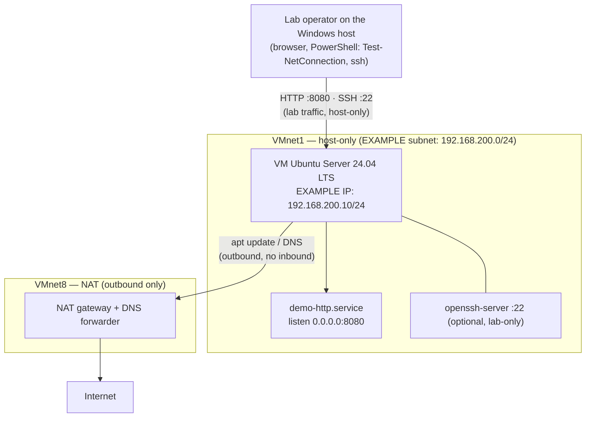

# Lab network diagram — Phase 1

English mirror of `docs/architecture/network-diagram.md` (Indonesian original
is the source of truth).

> **All IP addresses and subnets below are EXAMPLES**, not detected values.
> The actual VMnet1 subnet is assigned by VMware when first created — verify
> via the *Virtual Network Editor* on Windows or `ipconfig` (the
> `VMware Network Adapter VMnet1` adapter), then `ip -br a` on the VM.

## Diagram (Mermaid)

## Description

| Component | Role | Note |
|---|---|---|
| Windows host | Runs VMware Workstation; where the operator works | Workstation Pro is free for personal use (re-verify at install) |
| VMnet1 (host-only) | Isolated host ↔ VM lab network | No route to the internet; the basis of incident simulation |
| VMnet8 (NAT) | The VM's outbound path for `apt update` and DNS | No inbound port-forwarding |
| VM Ubuntu Server 24.04 LTS | Lab server; runs `demo-http.service` | 2 vCPU / 2 GB RAM / 25 GB disk (plan; adjust to host resources) |
| demo-http | Practice service; the target of baseline & incidents | Stdlib-only, fixed port 8080, hardened systemd unit |

## Trust boundaries

- VMnet1 is a **lab-only** network. Never bridge it to the physical LAN and
  never store real data on lab services.
- VMnet8 is outbound only. No inbound from the internet to the VM.
- Details and safety rules: `docs/security/safety-rules.en.md`.

## SVG version

A static SVG with the same content: `network-diagram.svg` (Indonesian labels)
and `network-diagram.en.svg` (English labels, in this folder). Mermaid in
this file is the source of truth; the SVGs are hand-made and can become
stale when the diagram changes — update them together.
