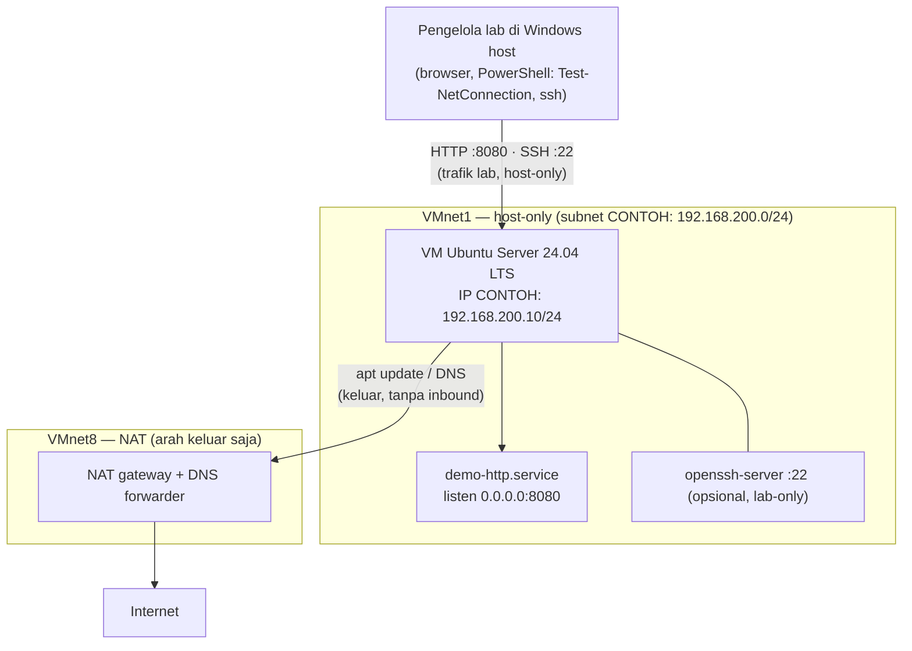

# Diagram jaringan lab — Fase 1

> **Semua alamat IP dan subnet di bawah adalah CONTOH**, bukan hasil deteksi.
> Subnet VMnet1 aktual ditentukan VMware saat pertama kali dibuat — verifikasi
> lewat *Virtual Network Editor* di Windows atau `ipconfig` (adapter
> `VMware Network Adapter VMnet1`), lalu `ip -br a` di VM.

## Diagram (Mermaid)

## Deskripsi

| Komponen | Peran | Catatan |
|---|---|---|
| Windows host | Menjalankan VMware Workstation; tempat pengelola bekerja | Versi Pro gratis untuk personal use (verifikasi ulang saat instalasi) |
| VMnet1 (host-only) | Jaringan lab terisolasi host ↔ VM | Tidak ada rute ke internet; basis simulasi insiden |
| VMnet8 (NAT) | Jalur keluar VM untuk `apt update` dan DNS | Tanpa port-forwarding inbound |
| VM Ubuntu Server 24.04 LTS | Server lab; menjalankan `demo-http.service` | 2 vCPU / 2 GB RAM / 25 GB disk (rencana; disesuaikan sumber daya host) |
| demo-http | Layanan latihan; objek baseline & insiden | Stdlib-only, port tetap 8080, unit systemd dengan hardening ringan |

## Batas kepercayaan

- VMnet1 adalah jaringan **lab-only**. Jangan bridging ke LAN fisik dan jangan
  simpan data nyata di layanan lab.
- VMnet8 hanya untuk arah keluar. Tidak ada inbound dari internet ke VM.
- Detail dan aturan keselamatan: `docs/security/safety-rules.md`.

## Versi SVG

Gambar SVG statis dengan isi yang sama: `network-diagram.svg` (di folder ini).
Mermaid di file ini adalah sumber kebenaran; SVG dibuat manual dan bisa
kedaluwarsa bila diagram berubah — ubah keduanya sekaligus.
